# Illos: free animated SVG illustrations

50 animated SVG illustrations for product sites, from [Illos](https://illos.dev?ref=github). Each one explains one idea, like a queue, a rate limit or a vector search, in one of three themes: Shader, HUD and Isometric.

- **Free for personal and commercial use, with no credit needed.** See [LICENSE.md](LICENSE.md).
- **Light and dark built in.** Each file follows the visitor's colour scheme.
- **One file, nothing to install.** Plain SVG with CSS animation: no Lottie player, no JavaScript runtime.
- **Calm by default.** Each one plays once and holds its final frame, and shows a still frame to visitors who turn motion off.

Browse them with live previews at [illos.dev/library/free](https://illos.dev/library/free?ref=github).

## Use one

**As an image.** The simplest option. It animates, but it can't follow your page's colours.

```html
```

**Inline.** Paste the file's `<svg>` into your HTML. It can follow your theme and your page can pause it.

**As a React component**, through the shadcn CLI:

```bash
npx shadcn@latest add https://illos.dev/r/isometric/queue.json
```

Then place `<IllosQueue />` where you want it. It plays once when it scrolls into view and loops while hovered.

The address is `https://illos.dev/r/<theme>/<name>.json`, where theme is `shader`, `hud` or `isometric` and name is the file name without `.svg`. The component name is `Illos` plus the name in PascalCase, so `rate-limit` becomes `IllosRateLimit`.

## With Claude Code, Cursor or Codex

[`skill/SKILL.md`](skill/SKILL.md) teaches a coding agent to pick the right illustration from [`catalog.json`](catalog.json) and place it well.

- **Claude Code:** copy the `skill` folder to `.claude/skills/illos-free-illustrations/` in your project.
- **Cursor, Codex and others:** add this line to your `AGENTS.md`:
  `For illustrations, follow https://raw.githubusercontent.com/navedux/illos-free-illustrations/main/skill/SKILL.md`

When you need an illustration that isn't here, [Illos Pro](https://illos.dev/pro?ref=github) adds the full library and skills that teach your agent to draw new ones in the same style, so a page made months later still matches.

## The illustrations

### Shader

A field of thin bars, with teal boxes on the part that matters: queues, caches, rate limits and AI ideas.

<table>
<tr><td width="33%" valign="top"><a href="https://illos.dev/library/shader/vector-search?ref=github"></a><br><b>Vector search</b><br><sub>A query lands among your vectors, and the nearest cluster lights up with its score.</sub></td><td width="33%" valign="top"><a href="https://illos.dev/library/shader/rate-limit?ref=github"></a><br><b>Rate limiting</b><br><sub>Traffic runs under the limit, and the burst above it is refused.</sub></td><td width="33%" valign="top"><a href="https://illos.dev/library/shader/streaming-tokens?ref=github"></a><br><b>Streaming tokens</b><br><sub>The answer streams in chunks, and the response writes itself out line by line.</sub></td></tr>
<tr><td width="33%" valign="top"><a href="https://illos.dev/library/shader/cache-layer?ref=github"></a><br><b>Cache layer</b><br><sub>A hit comes straight back from the cache, and a miss goes on to the database.</sub></td><td width="33%" valign="top"><a href="https://illos.dev/library/shader/load-balancer?ref=github"></a><br><b>Load balancer</b><br><sub>Traffic comes in one door, and the balancer spreads it across the servers in turn.</sub></td><td width="33%" valign="top"><a href="https://illos.dev/library/shader/autoscaling?ref=github"></a><br><b>Autoscaling</b><br><sub>As load rises new instances bud off it, and as it falls they fold back in.</sub></td></tr>
<tr><td width="33%" valign="top"><a href="https://illos.dev/library/shader/cdn-cache?ref=github"></a><br><b>CDN cache</b><br><sub>Content waits at edges near your users, so each request is answered close by.</sub></td><td width="33%" valign="top"><a href="https://illos.dev/library/shader/data-pipeline?ref=github"></a><br><b>Data pipeline</b><br><sub>Raw data flows in messy and leaves clean, combed calmer at every stage.</sub></td><td width="33%" valign="top"><a href="https://illos.dev/library/shader/queue-backlog?ref=github"></a><br><b>Queue backlog</b><br><sub>Jobs pour in faster than workers drain them, then the backlog levels off.</sub></td></tr>
<tr><td width="33%" valign="top"><a href="https://illos.dev/library/shader/webhook-fanout?ref=github"></a><br><b>Webhook fan-out</b><br><sub>One event rings out from the source and lands on every subscriber at once.</sub></td><td width="33%" valign="top"><a href="https://illos.dev/library/shader/billing-basin?ref=github"></a><br><b>Usage billing</b><br><sub>Usage fills the basin day by day, and at the month's end it drains into the invoice.</sub></td><td width="33%" valign="top"><a href="https://illos.dev/library/shader/rag?ref=github"></a><br><b>RAG answer</b><br><sub>The closest pages are pulled in, and the answer is written from them with citations.</sub></td></tr>
<tr><td width="33%" valign="top"><a href="https://illos.dev/library/shader/dns?ref=github"></a><br><b>DNS lookup</b><br><sub>The resolver asks the root, then COM, then the domain, and the address comes back.</sub></td><td width="33%" valign="top"><a href="https://illos.dev/library/shader/failover?ref=github"></a><br><b>Failover</b><br><sub>The primary region goes dark, and the router sends every request to the standby.</sub></td><td width="33%" valign="top"><a href="https://illos.dev/library/shader/ddos-shield?ref=github"></a><br><b>DDoS shield</b><br><sub>A flood of requests breaks on the shield, and the one real request gets through.</sub></td></tr>
<tr><td width="33%" valign="top"><a href="https://illos.dev/library/shader/data-warehouse?ref=github"></a><br><b>Data warehouse</b><br><sub>Raw data from three sources is cleaned into rows, and one query reads across all three.</sub></td><td width="33%" valign="top"><a href="https://illos.dev/library/shader/tool-calls?ref=github"></a><br><b>Tool calls</b><br><sub>The agent calls search, code and calendar in turn, ticking off each step of the task.</sub></td></tr>
</table>

### HUD

In the style of a heads-up display: wireframes and instrument readouts for monitoring, maps, metrics and AI.

<table>
<tr><td width="33%" valign="top"><a href="https://illos.dev/library/hud/edge?ref=github"></a><br><b>Edge network</b><br><sub>Requests reach the nearest edge of your network, wherever they start.</sub></td><td width="33%" valign="top"><a href="https://illos.dev/library/hud/monitoring?ref=github"></a><br><b>Monitoring</b><br><sub>A sweep checks every service, and the one in trouble raises an alert.</sub></td><td width="33%" valign="top"><a href="https://illos.dev/library/hud/search?ref=github"></a><br><b>Search index</b><br><sub>A query drops through the index and finds its match.</sub></td></tr>
<tr><td width="33%" valign="top"><a href="https://illos.dev/library/hud/traffic?ref=github"></a><br><b>Traffic map</b><br><sub>Requests flow along the routes of your map, busiest first.</sub></td><td width="33%" valign="top"><a href="https://illos.dev/library/hud/orbit?ref=github"></a><br><b>Scheduler</b><br><sub>A job rides its schedule and fires each run on time.</sub></td><td width="33%" valign="top"><a href="https://illos.dev/library/hud/signals?ref=github"></a><br><b>Event broadcast</b><br><sub>One event goes out, and every subscriber receives it.</sub></td></tr>
<tr><td width="33%" valign="top"><a href="https://illos.dev/library/hud/cost-meter?ref=github"></a><br><b>Cost meter</b><br><sub>Spend climbs toward the budget, and a forecast mark shows where the month will end.</sub></td><td width="33%" valign="top"><a href="https://illos.dev/library/hud/latency-heatmap?ref=github"></a><br><b>Latency heatmap</b><br><sub>Cells warm where requests are slow, and the hottest route is flagged with its p99.</sub></td><td width="33%" valign="top"><a href="https://illos.dev/library/hud/incident-timeline?ref=github"></a><br><b>Incident timeline</b><br><sub>An alert fires on the timeline, and the incident runs to resolved fifteen minutes later.</sub></td></tr>
<tr><td width="33%" valign="top"><a href="https://illos.dev/library/hud/log-stream?ref=github"></a><br><b>Log stream</b><br><sub>Log lines scroll past, and the one error is caught and pinned.</sub></td><td width="33%" valign="top"><a href="https://illos.dev/library/hud/billing-stack?ref=github"></a><br><b>Usage billing</b><br><sub>A month of daily usage adds up, and only on day 30 does the invoice print its total.</sub></td><td width="33%" valign="top"><a href="https://illos.dev/library/hud/alerts?ref=github"></a><br><b>Alerts</b><br><sub>A metric crosses its threshold, the bell rings, and one key press acknowledges it.</sub></td></tr>
<tr><td width="33%" valign="top"><a href="https://illos.dev/library/hud/threat-detection?ref=github"></a><br><b>Threat detection</b><br><sub>The scan sweeps the network, finds the packet that does not belong, and cages it.</sub></td><td width="33%" valign="top"><a href="https://illos.dev/library/hud/server-health?ref=github"></a><br><b>Server health</b><br><sub>A job heats the server up, and its fans spin up to bring the temperature down.</sub></td><td width="33%" valign="top"><a href="https://illos.dev/library/hud/api-status?ref=github"></a><br><b>API status</b><br><sub>An endpoint's latency crosses the SLO, its light turns red, and the next check clears it.</sub></td></tr>
<tr><td width="33%" valign="top"><a href="https://illos.dev/library/hud/audit-log?ref=github"></a><br><b>Audit log</b><br><sub>Every action is printed on the tape with who and when, and wound onto a locked spool.</sub></td></tr>
</table>

### Isometric

Technical illustrations in isometric line art: servers, pipelines, payments and deploys drawn as labelled machines.

<table>
<tr><td width="33%" valign="top"><a href="https://illos.dev/library/isometric/queue?ref=github"></a><br><b>Queue</b><br><sub>Jobs wait their turn, and the worker takes the next one.</sub></td><td width="33%" valign="top"><a href="https://illos.dev/library/isometric/billing?ref=github"></a><br><b>Usage billing</b><br><sub>Usage stacks up in the meter, and at the end of the month it prints the invoice.</sub></td><td width="33%" valign="top"><a href="https://illos.dev/library/isometric/cron?ref=github"></a><br><b>Cron jobs</b><br><sub>The clock reaches each mark and stamps a job onto the belt, right on schedule.</sub></td></tr>
<tr><td width="33%" valign="top"><a href="https://illos.dev/library/isometric/email?ref=github"></a><br><b>Email delivery</b><br><sub>Letters land in their pigeonholes, and one comes back as a bounce.</sub></td><td width="33%" valign="top"><a href="https://illos.dev/library/isometric/uploads?ref=github"></a><br><b>File uploads</b><br><sub>A file splits into chunks that drop down the chute and come back together in storage.</sub></td><td width="33%" valign="top"><a href="https://illos.dev/library/isometric/notifications?ref=github"></a><br><b>Notifications</b><br><sub>The bell rings and a card lands on top of the stack on the phone.</sub></td></tr>
<tr><td width="33%" valign="top"><a href="https://illos.dev/library/isometric/version-control?ref=github"></a><br><b>Version control</b><br><sub>A branch leaves main, picks up a commit and merges back in.</sub></td><td width="33%" valign="top"><a href="https://illos.dev/library/isometric/migration?ref=github"></a><br><b>Database migration</b><br><sub>Rows move from the old table into the new one and pick up the new column on the way.</sub></td><td width="33%" valign="top"><a href="https://illos.dev/library/isometric/image-processing?ref=github"></a><br><b>Image processing</b><br><sub>A photo goes into the press and comes out in three sizes.</sub></td></tr>
<tr><td width="33%" valign="top"><a href="https://illos.dev/library/isometric/analytics?ref=github"></a><br><b>Analytics funnel</b><br><sub>Events drop through the funnel, and the chart rises bar by bar.</sub></td><td width="33%" valign="top"><a href="https://illos.dev/library/isometric/database?ref=github"></a><br><b>Database</b><br><sub>A query goes in, the read head climbs to the right tier, and the rows come back out.</sub></td><td width="33%" valign="top"><a href="https://illos.dev/library/isometric/firewall?ref=github"></a><br><b>Firewall</b><br><sub>The rule plate lets port 443 through the gate and drops port 23 into the box below.</sub></td></tr>
<tr><td width="33%" valign="top"><a href="https://illos.dev/library/isometric/encryption?ref=github"></a><br><b>Encryption</b><br><sub>A readable card goes in and comes out sealed, and only the key opens it again.</sub></td><td width="33%" valign="top"><a href="https://illos.dev/library/isometric/two-factor?ref=github"></a><br><b>Two-factor sign-in</b><br><sub>A fresh code shows on the token, and the lock opens only once it is keyed in.</sub></td><td width="33%" valign="top"><a href="https://illos.dev/library/isometric/containers?ref=github"></a><br><b>Containers</b><br><sub>The crane lowers a new container into the host, and its light comes on as it runs.</sub></td></tr>
<tr><td width="33%" valign="top"><a href="https://illos.dev/library/isometric/api-gateway?ref=github"></a><br><b>API gateway</b><br><sub>Each request is checked at the gateway and turned toward the service it belongs to.</sub></td><td width="33%" valign="top"><a href="https://illos.dev/library/isometric/ci-pipeline?ref=github"></a><br><b>CI pipeline</b><br><sub>A commit rides through build, test and ship, and each check lights as it passes.</sub></td></tr>
</table>

## Licence

Use them in personal and commercial work, including client work, with no credit. You can change the files. You can't sell them as a pack or use them to build a competing library. Full terms: [illos.dev/license](https://illos.dev/license).

Made by [Naved Alam](https://illos.dev/about?ref=github). Questions: hello@illos.dev
